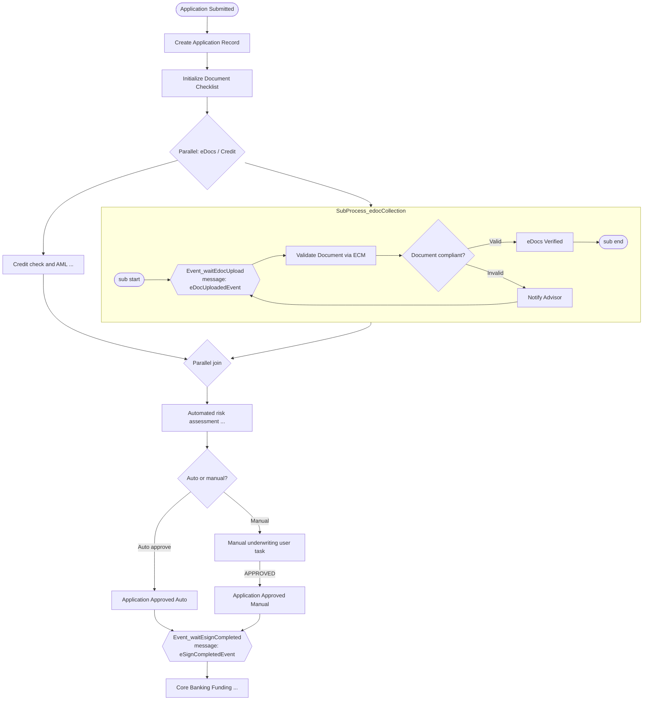

# Kafka ↔ Camunda（application-workflow）对接说明

面向 **ECM / eSign** 等外部系统与 **application-workflow** 集成团队。application-workflow 消费 Kafka 事件后，通过 Camunda 8 **Message Correlation** 推进 `application-workflow` 中的等待点。

**BPMN 文件：** `src/main/resources/process/application-workflow.bpmn`  
**Postman：** `src/main/resources/collection/application-workflow-camunda.postman_collection.json`（REST 等价路径，便于联调）

---

## 1. 两个 Message Catch 在流程中的位置

流程启动后，会先建单、初始化文档清单，再在 **并行网关** 上分叉：**eDoc 收集** 与 **征信/AML** 同时进行。Kafka 只对接下面两个 **Intermediate Message Catch Event**（不是 User Task，Operate 里不能「Complete」，只能发消息）。

| BPMN 元素 ID | 界面名称 | Camunda message name | 何时会处于 Waiting |
|--------------|----------|----------------------|-------------------|
| `Event_waitEdocUpload` | Wait for eDoc Upload | `eDocUploadedEvent` | 进入子流程 `SubProcess_edocCollection` 后；文档不合规通知顾问后也会 **再次回到** 此等待点 |
| `Event_waitEsignCompleted` | eSign Completed | `eSignCompletedEvent` | **自动批核**（`Task_updateStatusAutoApproved`）或 **人工批核通过**（`Task_updateStatusManualApproved`）之后，进入放款前 |

**关联键（correlation key）：** 流程变量 **`applicationId`**，必须与启动 application-workflow 时传入的 `applicationId` / 业务单号一致。



### Kafka 与 REST 的对应关系

| 入口 | Topic / API | 唤醒的 BPMN 节点 |
|------|-------------|------------------|
| Kafka | `edoc.uploaded`（可配置） | `Event_waitEdocUpload` |
| Kafka | `esign.completed`（可配置） | `Event_waitEsignCompleted` |
| REST | `POST /api/workflow/messages/edoc-uploaded` | 同上（无 TTL 缓冲，见下文） |
| REST | `POST /api/workflow/messages/esign-completed` | 同上 |

Kafka 路径使用 `CamundaMessageBridge`：若实例尚未订阅消息（Camunda 返回 404），会 **publishMessage + 1h TTL** 缓冲，避免「事件早于流程到达 catch」时丢失。

---

## 2. Topic 与消息体（JSON）

- **Key：** 建议与 `applicationId` 相同（便于分区与排查；也参与幂等 fallback）。
- **Value：** UTF-8 JSON，`Content-Type` 由生产方约定即可；application-workflow 使用 Jackson 反序列化。
- **Charset：** UTF-8。

### 2.1 `edoc.uploaded` → `eDocUploadedEvent`

**默认 topic：** `edoc.uploaded`（`application-workflow.integration.kafka.topics.edoc-uploaded`）

```json
{
  "applicationId": "APP-2026-00042",
  "documentId": "DOC-income-001",
  "status": "UPLOADED",
  "messageId": "ecm-event-7f3c2a1b-4d5e-6f78-9012-3456789abcde"
}
```

| 字段 | 必填 | 说明 |
|------|------|------|
| `applicationId` | 是 | 与 application-workflow 启动变量一致，用作 **correlationKey** |
| `documentId` | 否 | 写入流程变量 `documentId` |
| `status` | 否 | 写入流程变量 `documentStatus` |
| `messageId` | 否 | 幂等去重优先使用；建议 ECM 每条事件唯一 ID |

未知字段会被忽略（`@JsonIgnoreProperties(ignoreUnknown = true)`）。

### 2.2 `esign.completed` → `eSignCompletedEvent`

**默认 topic：** `esign.completed`（`application-workflow.integration.kafka.topics.esign-completed`）

```json
{
  "applicationId": "APP-2026-00042",
  "envelopeId": "ENV-998877",
  "status": "COMPLETED",
  "messageId": "esign-webhook-20261020-001"
}
```

| 字段 | 必填 | 说明 |
|------|------|------|
| `applicationId` | 是 | correlationKey |
| `envelopeId` | 否 | 流程变量 `eSignEnvelopeId` |
| `status` | 否 | 流程变量 `eSignStatus` |
| `messageId` | 否 | 幂等去重 |

---

## 3. 环境变量与配置清单

### 3.1 本地 / 通用

| 变量 / 配置 | 默认值 | 说明 |
|-------------|--------|------|
| `KAFKA_INTEGRATION_ENABLED` | `false` | `true` 时启用 `@KafkaListener` 与 `@EnableKafka` |
| `KAFKA_BOOTSTRAP_SERVERS` | `localhost:9092` | `spring.kafka.bootstrap-servers` |
| `KAFKA_CONSUMER_GROUP` | `application-workflow` | Consumer group |
| `KAFKA_TOPIC_EDOC_UPLOADED` | `edoc.uploaded` | eDoc topic |
| `KAFKA_TOPIC_ESIGN_COMPLETED` | `esign.completed` | eSign topic |
| `REDIS_IDEMPOTENCY_ENABLED` | `false` | `true` 时使用 Redis `SET NX` 去重 |
| `REDIS_HOST` / `REDIS_PORT` / `REDIS_PASSWORD` | `localhost` / `6379` / 空 | 幂等开启时需要 |
| `IDEMPOTENCY_TTL` | `PT24H` | Redis 幂等键 TTL |
| `IDEMPOTENCY_KEY_PREFIX` | `idempotency:` | Redis key 前缀 |
| `CAMUNDA_GRPC_ADDRESS` | `http://localhost:26500` | Zeebe gRPC |
| `CAMUNDA_REST_ADDRESS` | `http://localhost:8080` | Operate/API |
| `SERVER_PORT` | `8081` | application-workflow HTTP |

对应 `application.yaml` 中的 `application-workflow.integration.*` 与 `spring.kafka.*`。

### 3.2 AWS MSK（IAM）

激活 **`SPRING_PROFILES_ACTIVE=aws-msk`**，加载 `application-aws-msk.yaml`：

- `spring.kafka.properties.security.protocol=SASL_SSL`
- `sasl.mechanism=AWS_MSK_IAM`
- 默认 **`application-workflow.integration.kafka.enabled=true`**
- 默认 **`application-workflow.integration.idempotency.enabled=true`**

生产 MSK 时请在运行环境配置 **MSK bootstrap brokers**（`KAFKA_BOOTSTRAP_SERVERS`）与 **ElastiCache Redis**。  
`aws-msk-iam-auth` 等 IAM 客户端库需在部署侧按 AWS 文档加入 classpath（见 `application-aws-msk.yaml` 注释）。

---

## 4. 幂等与消费语义

- Consumer：**手动 ack（按 record）**，`enable-auto-commit: false`。
- 幂等键：`{eventType}:{applicationId}:{dedupeToken}`，其中 `dedupeToken` = `messageId` → Kafka key → `partition@offset`。
- 重复消息：Redis 开启时静默跳过；未开启时可能多次 correlate（生产环境建议开启 Redis）。
- correlate 失败且非 404：释放幂等键，Kafka 可重试。

---

## 5. 联调顺序（Happy path）

1. 启动 Camunda（如 c8run `:8080`）与 application-workflow（`:8081`），`KAFKA_INTEGRATION_ENABLED=true` 且 Kafka 可达。
2. `POST /api/workflow/etrack/start`，body 含 **`applicationId`**（记下该值）。
3. 在 Operate 确认实例到达 **Wait for eDoc Upload**（或并行分支仍在跑征信）。
4. 向 **`edoc.uploaded`** 发送 §2.1 JSON（`applicationId` 一致）。
5. 流程经 ECM 校验、eDoc 子流程结束，并与征信分支汇合后继续风控/批核。
6. 批核通过后，实例在 **eSign Completed** 等待。
7. 向 **`esign.completed`** 发送 §2.2 JSON。
8. 实例进入 **Core Banking Funding** 及后续通知。

无 Kafka 时可用 Postman 中 **Correlate eDoc uploaded / eSign completed** 代替步骤 4、7（注意 REST 无 404 缓冲，需在实例 **已处于 Waiting** 时再发）。

---

## 6. 常见问题

| 现象 | 可能原因 |
|------|----------|
| Operate 仍 Waiting，Kafka 已发 | `applicationId` 不一致；或消息名不是 `eDocUploadedEvent` / `eSignCompletedEvent` |
| Consumer 无日志 | `KAFKA_INTEGRATION_ENABLED=false` 或 topic 名不匹配 |
| 事件很早到达 | Kafka 路径会 publish + TTL；REST 需等实例到 catch 或使用 Camunda v2 publication |
| 重复推进 | 开启 `REDIS_IDEMPOTENCY_ENABLED` 并为每条事件提供 `messageId` |

---

## 7. 代码索引

| 职责 | 类 |
|------|-----|
| Kafka 消费 eDoc | `EDocUploadedKafkaConsumer` |
| Kafka 消费 eSign | `ESignCompletedKafkaConsumer` |
| correlate / buffer | `CamundaMessageBridge` |
| REST 联调 | `WorkflowController` / `WorkflowTaskService` |
| 开关与 topic | `IntegrationProperties`, `WorkflowKafkaIntegrationConfiguration` |
